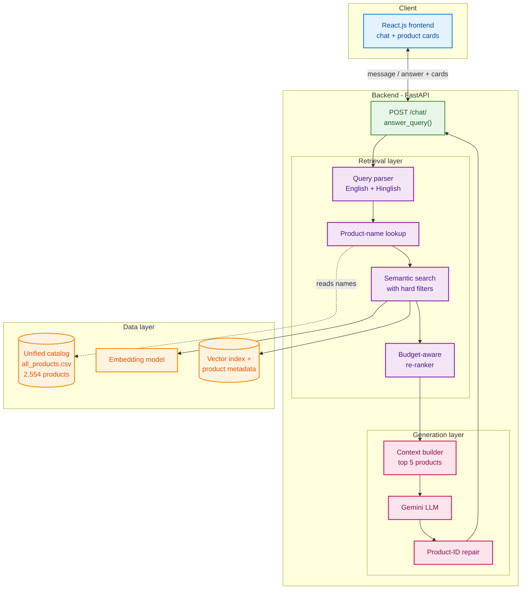
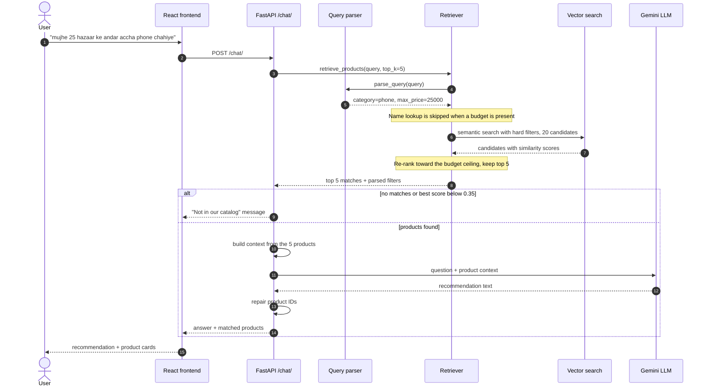
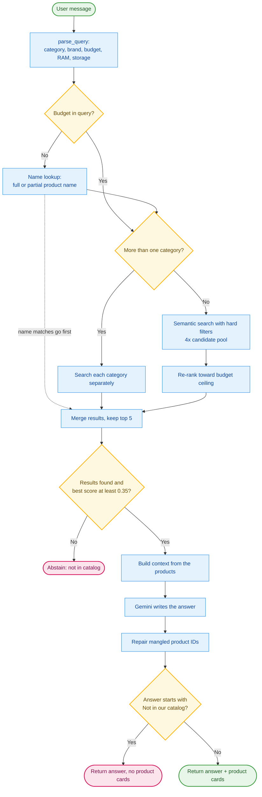
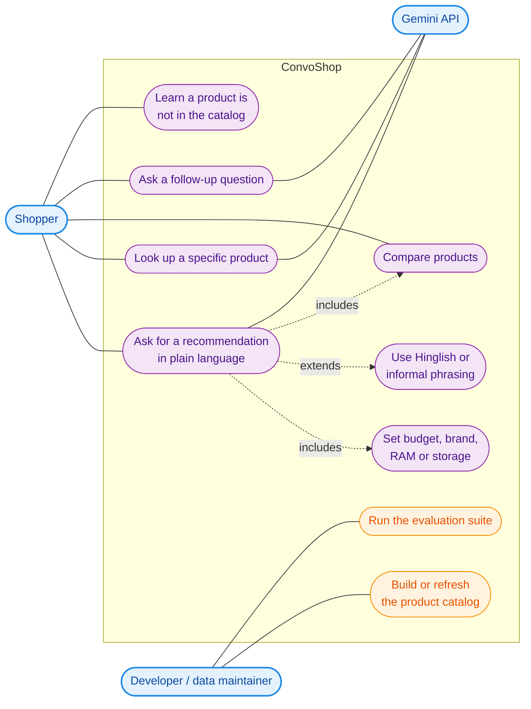
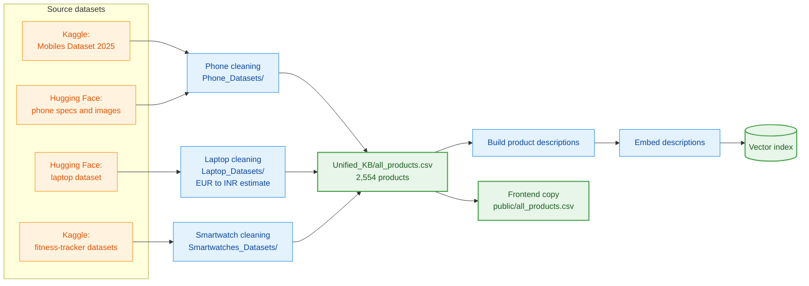

# ConvoShop

### A Retrieval-Augmented Generation Framework for Intent-Driven E-Commerce Product Advisory

ConvoShop is a conversational product advisor for **phones, laptops and smartwatches**. A shopper describes what they need in plain English or Hinglish. The system extracts hard constraints (category, brand, budget, RAM, storage), retrieves matching products from a unified catalog, and uses a Gemini model to write a recommendation that is grounded in the retrieved product data. If a product is not in the catalog, ConvoShop says so instead of guessing.

> **Example:** *"mujhe 25 hazaar ke andar accha phone chahiye"* is parsed as `category = phone, max_price = 25000`. Only phones within the budget are retrieved, and the answer lists real products with prices taken from the catalog.

## Contents

1. [Key features](#1-key-features)
2. [System architecture](#2-system-architecture)
3. [How it works](#3-how-it-works)
4. [Use cases](#4-use-cases)
5. [Catalog and data pipeline](#5-catalog-and-data-pipeline)
6. [Query understanding](#6-query-understanding)
7. [Repository structure](#7-repository-structure)
8. [Setup and running](#8-setup-and-running)
9. [Evaluation](#9-evaluation)
10. [Limitations](#10-limitations)
11. [Future scope](#11-future-scope)

## 1. Key features

| Feature | What it does |
|---|---|
| **Hard constraints** | Budget, brand, category, RAM and storage are applied as filters on retrieval, not left to the LLM. |
| **English + Hinglish budgets** | Understands `under 25,000`, `25k`, `1.5 lakh tak`, `25 hazaar ke andar`, `50 hazaar se upar`. |
| **Hybrid retrieval** | Semantic search for meaning, exact and partial product-name lookup for named products. |
| **Budget-aware ranking** | Among products inside the budget, ones closer to the ceiling rank higher (skipped for "cheap" or "sasta" queries). |
| **Grounded answers** | The LLM only sees retrieved products. Prices, specs and IDs are checked against the catalog. |
| **Abstention** | Returns "Not in our catalog" when nothing relevant is found, for example an unreleased model. |
| **ID repair** | Fixes product IDs the LLM mangles (for example `ph_078` instead of `ph_0078`) using the IDs actually retrieved. |

## 2. System architecture



### Components

| Component | Technology | Responsibility |
|---|---|---|
| Frontend | React.js | Chat interface and product cards |
| API | FastAPI | `POST /chat/` endpoint, orchestration |
| Query parser | Python (`query_parser.py`) | Extracts category, brand, budget, RAM and storage from English and Hinglish |
| Retriever | Python (`retriever.py`) | Name lookup, semantic search, budget-aware re-ranking |
| Embeddings and vector search | Sentence Transformer / Pinecone (`embeddings.py`, `vector_services.py`) | Semantic similarity search with metadata filters |
| Product metadata | MongoDB Atlas | Structured product records |
| RAG pipeline | Python (`rag_pipeline.py`) | Abstain check, context building, LLM call, ID repair |
| LLM | Gemini (`llm.py`) | Writes the recommendation and explanation |

<!-- TODO: confirm the embedding model, vector store and metadata store against vector_services.py and embeddings.py before submitting. embeddings.py imports google.generativeai, so the embedding model may be a Gemini model rather than a Sentence Transformer. Also add the exact Gemini model string from llm.py. -->

## 3. How it works

### 3.1 End-to-end request flow



### 3.2 Decision flow inside the backend



### 3.3 Step by step

1. **Parse the query.** `query_parser.py` pulls out category, brand, minimum and maximum price, RAM and storage. It understands Hinglish number words (`hazaar`, `lakh`) and Hinglish phrases (`ke andar`, `tak`, `se upar`). Durations such as "upto 21 days" are not mistaken for budgets.
2. **Look up named products.** If the query contains a product name, full or partial, those catalog entries are placed first. This is skipped for budget queries, which are shopping queries and not name lookups. A model number that the product lacks (for example "XPS 17 9999") rules the match out.
3. **Search semantically.** The query is embedded and matched against the vector index. Filters from step 1 are hard constraints. The retriever fetches 4 times more candidates than needed.
4. **Re-rank.** When there is a budget, products closer to the ceiling get a small score bonus, so a "phone under 50k" query is not answered only with the cheapest phones. Queries containing "cheap" or "sasta" skip this step.
5. **Abstain if needed.** If no products are found, or the best similarity score is below 0.35, the system answers "Not in our catalog".
6. **Build context.** Each of the top 5 products becomes a text block with ID, category, brand, name, price, RAM, storage, screen, battery and a shortened description. Laptop prices converted from EUR are marked as estimates.
7. **Generate.** Gemini writes the recommendation from this context only.
8. **Repair IDs.** Any product ID in the answer that is not one of the retrieved IDs is mapped back to the closest retrieved ID.
9. **Respond.** The frontend shows the answer text and the matched products as cards.

### 3.4 Key parameters

| Parameter | Value | Where |
|---|---|---|
| Products sent to the LLM | 5 | `rag_pipeline.py` |
| Similarity cutoff for abstaining | 0.35 | `rag_pipeline.py` |
| Candidate pool multiplier | 4 | `retriever.py` |
| Budget re-rank bonus | 0.15 | `retriever.py` |

### 3.5 Follow-up questions

Follow-up questions such as "why is this better?" go through the same pipeline. <!-- TODO: describe how session context is stored and passed for follow-ups, from the API layer. -->

## 4. Use cases



| Use case | Example query | Behaviour |
|---|---|---|
| Recommendation | "best phone under 25000" | Filters to phones within budget, then ranks and explains |
| Hinglish | "60k ke andar coding ke liye laptop" | Parsed as a laptop with a 60,000 ceiling |
| Specific lookup | "price of Garmin Instinct 2S Solar" | Name lookup finds the product directly |
| Comparison | "compare the top two" | The answer includes a comparison section |
| Out of catalog | "iPhone 17 Pro Max 1TB" | Abstains instead of inventing a product |

## 5. Catalog and data pipeline

### 5.1 Unified catalog

`Unified_KB/all_products.csv` is the single source of truth. The frontend keeps an identical copy at `Frontend/my-react-app/public/all_products.csv`.

| Category | Products | Price basis |
|---|---:|---|
| Phones | 271 | Launch prices in INR (phones launched 2024 to 2025) |
| Laptops | 1,453 | EUR prices converted at an estimated 1 EUR = 110 INR, marked `converted_from_EUR` in `price_source` |
| Smartwatches | 830 | INR. Some prices repeat across many products and may be fallback estimates |
| **Total** | **2,554** | |

Columns: `product_id`, `category`, `brand`, `name`, `price_inr`, `price_source`, `rating`, `launched_year`, `ram_gb`, `storage_gb`, `screen_in`, `battery_mah`, `battery_days`, `image_url`, `has_image`, `description`, `specs_json`.

### 5.2 Pipeline



### 5.3 Sources and licensing

| Data | Source | Licence |
|---|---|---|
| Phone specs and launch prices | Kaggle: Abdul Malik, [Mobiles Dataset (2025)](https://www.kaggle.com/datasets/abdulmalik1518/mobiles-dataset-2025) | Treat the Kaggle dataset page as authoritative. A licence shown on a Kaggle notebook is the notebook's, not the dataset's. |
| Phone specs and images | Hugging Face: [Nadirova/Phone_SpecsDataset_25K](https://huggingface.co/datasets/Nadirova/Phone_SpecsDataset_25K) | No licence declared in the dataset card. Confirm redistribution rights with the author before committing a processed copy. |
| Laptops | Hugging Face: Santhoshwar2204/laptop | Confirm on the dataset page |
| Smartwatches | Kaggle fitness-tracker datasets (authors arnabchaki and devsubhash) | Confirm on each dataset page |

<!-- TODO: add exact URLs for the laptop and smartwatch sources. -->

The repository is public. Do not commit raw or processed copies of a source dataset unless its licence clearly allows redistribution. Keep downloads under `data/raw/`, which is gitignored.

## 6. Query understanding

| Query | Parsed filters |
|---|---|
| `mujhe 25 hazaar ke andar accha phone chahiye` | `category=phone`, `max_price=25000` |
| `60k ke andar coding ke liye laptop` | `category=laptop`, `max_price=60000` |
| `phone under 25,000` | `category=phone`, `max_price=25000` |
| `laptop with 16gb ram under 1 lakh` | `category=laptop`, `ram_gb=16`, `max_price=100000` |
| `phone 8gb ram 256gb storage under 30k` | `category=phone`, `ram_gb=8`, `storage_gb=256`, `max_price=30000` |
| `50 hazaar se upar ka phone` | `category=phone`, `min_price=50000` |
| `Garmin Instinct 2S Solar, Battery Upto 21 day` | `brand=Garmin` (the duration is not read as a budget) |

## 7. Repository structure

```text
final_year/
├── Backend/
│   ├── app/
│   │   ├── main.py                 # FastAPI app, POST /chat/
│   │   ├── rag_pipeline.py         # answer_query(): retrieve, build context, LLM, ID repair
│   │   └── services/
│   │       ├── query_parser.py     # English + Hinglish filter extraction
│   │       ├── retriever.py        # name lookup, semantic search, re-ranking
│   │       ├── vector_services.py  # vector search with metadata filters
│   │       ├── embeddings.py       # embedding calls
│   │       └── llm.py              # Gemini generation and abstain message
│   ├── eval_extra.py               # evaluation suite (calls the running server)
│   └── requirements.txt
├── Frontend/
│   └── my-react-app/
│       └── public/all_products.csv
├── Phone_Datasets/                 # phone data pipeline
├── Laptop_Datasets/                # laptop data pipeline
├── Smartwatches_Datasets/          # smartwatch data pipeline
├── Unified_KB/
│   └── all_products.csv            # unified catalog (source of truth)
├── data/raw/                       # downloaded source data (gitignored)
├── .env.example
└── README.md
```

<!-- TODO: check this tree against the real layout, for example with: tree /F /A in PowerShell. -->

## 8. Setup and running

### Prerequisites

- Python 3.10 or newer
- Node.js and npm
- API access for Gemini, plus the vector store and database configured in `.env` (see `.env.example`)

### Clone

```bash
git clone https://github.com/Veenashree22533/final_year.git
cd final_year
```

### Data

Download the source datasets yourself (they are not in the repository), place them under `data/raw/`, and run the cleaning code for each category. The phone pipeline ends with:

```bash
python build_descriptions.py
```

The phone cleaning run should report **271 phone records**.

### Backend

```powershell
cd Backend
python -m venv .venv
.\.venv\Scripts\Activate.ps1
pip install -r requirements.txt
uvicorn app.main:app --reload
```

The API is then available at `http://127.0.0.1:8000/chat/`.

### Frontend

```bash
cd Frontend/my-react-app
npm install
npm run dev
```

## 9. Evaluation

`Backend/eval_extra.py` is a regression suite that calls the running server with real LLM requests. Start the backend first, then run:

```powershell
python eval_extra.py
```

Results from the run :

| Section | Passed | Target |
|---|---:|---:|
| Hard constraints (budget, brand, category, RAM) | 6 / 6 | 100% |
| Answer accuracy on answerable questions | 11 / 12 | 90% |
| Abstention on products not in the catalog | 8 / 8 | 100% |
| Paraphrases, typos and Hinglish | 9 / 9 | 80% |
| Stability (same question 3 times, same top pick) | 2 / 2 | 80% |
| Follow-up consistency | 2 / 2 | 100% |
| Grounding (IDs exist, prices match the catalog) | 45 / 45 | 100% |
| Reliability | no errors, median 2.5 s, p95 4.0 s | p95 under 15 s |

**Read these numbers with care.** Each section has only 2 to 12 tests, so one answer changes a score by 8 to 50 points, and LLM output varies from run to run. The suite shows that known bugs are fixed. It is not a statistically meaningful benchmark. A larger query set with Precision@K, Recall@K, budget-constraint accuracy, and comparisons against keyword search and a standalone LLM is planned.

## 10. Limitations

- **Phone coverage.** Phones are limited to those launched in 2024 and 2025. The catalog currently has no Samsung phones under ₹25,000, only flagship models.
- **Prices are not live.** Phone prices are launch prices. Laptop prices are EUR prices converted at an estimated rate. Some smartwatch prices repeat across many products and may be fallback values. Check `price_source`.
- **Source-data errors.** Public datasets contain mistakes that carry into the answers. For example, the Kaggle data lists the iPhone 16 with an A17 Bionic chip, but it uses the A18.
- **Messy product names.** Some laptop names repeat the brand ("Samsung Samsung Galaxy Book") or contain Spanish words, and some product names are duplicated.
- **Partial image coverage.** Images exist for only some products.
- **LLM errors.** Grounding reduces unsupported claims but cannot rule out wrong statements. Product IDs in answers are repaired against retrieved IDs, but the prose itself is not fact-checked.
- **Closed catalog.** Products that are not in the catalog cannot be recommended.

## 11. Future scope

- Add budget phones from other brands and relax the launch-year filter.
- Clean laptop names and replace estimated prices with real INR prices.
- Larger evaluation set with standard retrieval metrics and baselines.
- Better follow-up handling and conversational memory.
- Live price and availability data.
- Migrate from the deprecated `google.generativeai` package to `google.genai`.

---

ConvoShop combines requirement parsing, hybrid retrieval, grounded generation and abstention into one conversational shopping advisor: understand the request, retrieve matching products under hard constraints, ground the LLM in the retrieved data, and say so when the catalog has no answer.
